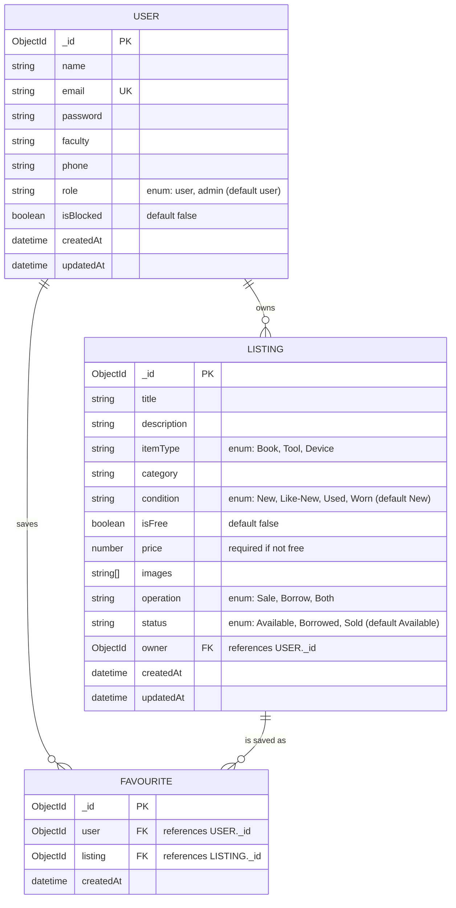

# Entity-Relationship Diagram (ERD) — Campus Books & Tools Share

This ERD is derived directly from the Mongoose schemas in `backend/models/`.

## Relationship Notes

- **USER → LISTING** (one-to-many): a user can own multiple listings (`Listing.owner`). Deleting a user cascades to delete their listings, associated Cloudinary images, and any favorites pointing to them.
- **USER → FAVOURITE** (one-to-many): a user can favorite multiple listings.
- **LISTING → FAVOURITE** (one-to-many): a listing can be favorited by multiple users.
- **USER + LISTING → FAVOURITE** (composite unique constraint): the `favourite` collection has a **unique compound index** on `(user, listing)` to prevent a user from favoriting the same listing twice.
- Deleting a **LISTING** cascades to delete any `FAVOURITE` documents referencing it, plus its images on Cloudinary.

## Field Validation Highlights

- `User.email` — must be unique and pass email format validation.
- `User.phone` — must match Egyptian mobile number pattern `^(01)[0-2,5]{1}[0-9]{8}$`.
- `User.password` — hashed with bcrypt before saving (min length 6, pre-save hook).
- `Listing.price` — required only when `isFree` is `false`; must be ≥ 0.
- `Listing.images` — required (at least handled at the application level via upload middleware, max 5 files, 5MB each, JPG/PNG/WEBP only).
